<picture>
  <source media="(prefers-color-scheme: dark)" srcset="./docs/assets/header-dark.svg">
  <source media="(prefers-color-scheme: light)" srcset="./docs/assets/header-light.svg">
  
</picture>

<p align="center">
  
  
  
</p>

**A console movie library built on a hand-written binary search tree.** This was the micro-project for *Computer Programming 3* at the Silesian University of Technology. The brief was to write your own STL-style container and adapt it to a topic. Mine was a binary search tree holding a movie database.

## 📦 The container: `BinaryTree<T>`

A generic BST in [`src/binary_tree.hpp`](src/binary_tree.hpp). It works with any `T` that has `<`, `>` and `==` defined.

| Operation | What it does |
|---|---|
| `add(value)` | recursive insert, rejects duplicates, returns whether the tree changed |
| `delete_(value)` | handles all three cases: leaf, one child, and two children (replaced by the in-order successor) |
| `find(value)` | recursive lookup, returns the node or `nullptr` |
| `in_order(fn)` / `print(asc)` | sorted traversal with a callback, A → Z or Z → A |
| `balanced_order(fn)` | visits the median first, then each half recursively (see below) |
| `copy_to_tree(value, other)` | copies one element into another tree |
| copy / move | deep-copy constructor, move constructor and move assignment |

**Memory:** every node owns its children through `std::unique_ptr`. There is no `new` or `delete` anywhere, and destroying the root frees the whole tree. Deletion hands subtrees around with `std::move` and gets the new subtree root back.

## 🎬 The app: movie library

`MovieLibrary` is a singleton that keeps two trees, the whole collection and your favourites, both keyed by title:

```text
[1] Sort A–Z          [5] Delete a movie        [9]  Add to favourites
[2] Sort Z–A          [6] Group by genre        [10] Show favourites
[3] Live search       [7] Group by director     [11] Save & exit
[4] Add a movie       [8] Stats (count, height, average rating, top genre/director)
```

- **Live search** refreshes the results after every key press using a prefix match on the title.
- **Grouping** builds a `std::map<std::string, BinaryTree<Movie>>`, so each group is itself a sorted tree.
- Records are validated on load: non-empty fields, a plausible year and a rating between 0 and 10.

## 🌳 Why the save order matters

<picture>
  <source media="(prefers-color-scheme: dark)" srcset="./docs/assets/save-order-dark.svg">
  <source media="(prefers-color-scheme: light)" srcset="./docs/assets/save-order-light.svg">
  
</picture>

The first version saved the library with an in-order traversal, which writes the movies alphabetically. On the next start every title was inserted to the right of the previous one, so the "tree" became a linked list of height 15 and every lookup was O(n).

Now the library is saved **median-first**: the middle title, then the middle of each half, and so on. Reloading that file rebuilds a perfectly balanced tree of height ⌈log₂(n+1)⌉, which is 4 for 15 movies. You can check the height with menu option [8].

## 🚀 Build & run

Any C++17 compiler works. Windows, Linux and macOS are supported.

```bash
cmake -S . -B build
cmake --build build
./build/movie_library                    # Windows: build\Debug\movie_library.exe
```

Run it from the repository root so it finds `data/movies.txt` and `data/favs.txt`, or pass both paths explicitly: `movie_library my_movies.txt my_favs.txt`.

Without CMake: `g++ -std=c++17 -O2 src/main.cpp -o movie_library`

The data format is one movie per line: `title,director,year,rating,genre`.

### Tests

[`tests/binary_tree_test.cpp`](tests/binary_tree_test.cpp) covers:
- insertion and duplicates
- all three deletion cases
- deep copy and move semantics
- rebuilding a balanced tree from a degenerate one

```bash
ctest --test-dir build --output-on-failure
```

## 🗂️ Repository

```
src/binary_tree.hpp     the container (Node<T>, BinaryTree<T>)
src/movie.hpp           Movie record, ordered by title
src/console.hpp         portable clear-screen / sleep / key-press helpers
src/main.cpp            MovieLibrary app and menu
data/                   movies.txt, favs.txt
tests/                  container unit tests
```
